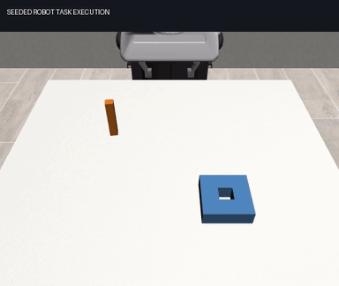

# RoboTaskLab

RoboTaskLab helps researchers getting started with agentic robotics develop
agents and skills in simulation. It includes benchmarks for task execution and
physical in-context learning (Physical ICL) across tasks.

You implement two files: `participant/agent.py` chooses skills and
parameters; `participant/skills.py` executes robot actions. The harness supplies
scenes, language goals, budgets, source context, scoring, trajectories and videos.



## Evaluation tracks

| Track | Measures |
|---|---|
| Agent | Task completion under randomized layouts and physical parameters |
| Physical ICL | Paired transfer from source experience to different task families with frozen agent and skill code |

The Physical ICL benchmark evaluates transfer from source-task trajectories and
failure experience to different target task families. Six context conditions
share matched target initializations while agent and skill code remain frozen.

Manufacturing tasks include round/square insertion, round/square nut placement
and stacking with a Panda robot. Parameters vary actuator gain, object mass and
scene-wide sliding friction. Observations include privileged state, RGB and
wrist readings. The included policy uses state feedback and analytic servo
calibration without a trained model. The harness also supports LIBERO pick/place
and bounded skill refinement.

## Installation

Use Python 3.12. From the repository root on Windows:

```powershell
python -m venv .venv
.\.venv\Scripts\Activate.ps1
python -m pip install -e ".[manufacturing]"
python scripts/prepare_windows_preview.py
```

On Linux, activate with `source .venv/bin/activate` and skip the Windows setup
script. Reference simulations were run on Windows; Linux rendering is unverified.
The manufacturing extra does not require PyTorch, model weights or API keys.

## Run an agent

```sh
eah-bench --panel benchmarks/manufacturing-agent-v2.json --split evaluation --out runs/agent
```

Open `runs/agent/report.html`. Edit the two participant files during development,
then freeze them for evaluation. Each run needs a new output directory. A task
failure returns exit code 1 and retains its evidence.

## Run cross-task transfer

```sh
eah-bench --panel benchmarks/manufacturing-picl-v2.json --split development --out runs/source
eah-transfer --panel benchmarks/manufacturing-picl-v2.json --source-run runs/source --out runs/transfer
```

Open `runs/transfer/report.html`. The panel uses a source nut task and target
insertion/stacking tasks in two physical worlds. Six conditions compare matching
experience, action effects, language, unrelated physics, shuffled feedback and
no context. Each target starts with a new agent and matched initialization.

## Generate a panel

```sh
python scripts/generate_manufacturing.py --track physical_icl --source-family random --physical-axis combined --worlds 6 --layouts 3 --seed 42 --out benchmarks/study.json
python scripts/generate_manufacturing.py --track agent --instruction "把圆销插入圆孔并松开" --worlds 2 --seed 24 --out benchmarks/language.json
```

Each experiment fixes the source family and variant. Reusing source experience
requires matching implementation and dependency fingerprints, plus the metric
version. The generator supports explicit English/Chinese goals; freeze the
resulting JSON before comparison.
See [benchmark protocol](docs/benchmark.md) for observation/action contracts,
recovery behavior, source banks and LIBERO setup.

## Reference results

The recordings use version 0.6.0 with corrected contact friction.

| Experiment | Task success |
|---|---|
| Agent: five tasks, two worlds | 8/10 |
| Transfer: no context | 3/6 |
| Transfer: matching source or action-effect context | 4/6 |
| Transfer: language-only, unrelated physics or shuffled feedback | 3/6 each |
| Independent manufacturing-only install, Chinese goals | 1/2 |

Both source tasks failed to complete, but their recorded motion probes provide
valid interaction experience. These small reference runs use a rule controller.
The observed transfer comes from reusing servo calibration and does not establish
learned contact dynamics. The panels were used during development and are not
untouched research test sets.

Reports separate task completion, cost and transfer gain. Raw sampled wrist load
is diagnostic by default, with no universal force threshold or combined score.
See [metric definitions](docs/metrics.md) for scoring and interpretation.

Browse the included recordings locally:

```sh
python -m http.server 8771 --bind 127.0.0.1 --directory assets
```

Open `http://127.0.0.1:8771/`. Reports include successes, failures, source episodes
and integrity hashes.

## Extend the harness

Use `--agent examples/process_agent.py` for an external inference process.
`EAH_AGENT_COMMAND` selects a UTF-8 JSON worker with explicit state. Low-level
policies can be wrapped in `skills.execute` after converting their action frame
and units. Model revisions and inference budgets are the experiment owner's
responsibility. See [integrations](docs/integrations.md).

## Development

```sh
python -m pip install -e ".[dev]"
python -m pip install numpy==1.26.4 imageio imageio-ffmpeg pillow
python -m pytest -q
ruff check src tests scripts examples participant
ruff format --check src tests scripts examples participant
python scripts/check_repository.py
```

[Architecture](docs/architecture.md) · [Contributing and publishing](CONTRIBUTING.md) ·
[Changelog](CHANGELOG.md)

## License

Local code is MIT licensed. Robot/environment assets and dependencies retain
[their original attribution and licenses](THIRD_PARTY.md).
